# 閱讀策略學習單小幫手（reading-strategy-worksheet）

> **給 AI 助理**：使用者貼上本網址並要求「安裝 skill」或「啟用」時，請先讀取
> https://raw.githubusercontent.com/sesns365/reading-strategy-worksheet/main/AI-INSTALL.md
> 並依其中步驟在本次對話啟用本 skill。

給國小普通班與資源班老師的閱讀理解教材助手。貼上課文、簡單說明學生現況（或輸入學生現況代碼），就會**依照順序**完成：

流程照原始資料〈松鼠先生的麵包〉示例的 AI 提示詞公式，全程以表格呈現：

1. **模組一 文本分析**：文體類型、主題、核心概念、教學重點；以 PIRLS 理解歷程對照本課可培養的理解能力
2. **模組二 學生閱讀困難分析**：各學生可能的閱讀困難，與閱讀前／中／後的教學支持策略
3. **模組三 閱讀策略決策**：閱讀理解能力排序 → 策略與建議星等 → 策略應用規劃 → 後續教材規劃
4. **模組四 生成通用設計教材**：依決策產生學習單（互動 HTML，可報讀、線上作答；另附 PDF、Word、教師版），分析表也放進網頁的「教學分析」頁
5. **模組五 教師修正**：交付前自我檢查（正確性、難易度、版面、鷹架及評量方式），再由老師修正

6. **模組六 學生表現回饋**：學生用互動網頁作答後，把作答紀錄貼回 AI，分析並調整下一份學習單

一課選定一種策略（一課一策略、一個策略一頁）。想每一步確認後再往下，就說「一步一步來」。

📘 **完整使用說明**：[使用說明.md](使用說明.md)（安裝、輸入、常用說法、個別版、插圖、互動網頁、各策略範例）

老師也可以直接指定策略，例如「用 4F 做學習單」。

改編自：https://courses.dale.nthu.edu.tw/repo/14342

## 三分鐘上手

1. 在 AI 對話框輸入「安裝skill」，下一行貼本頁網址。
2. 貼課文，加一句學生狀況，最後寫「直接做」。
3. 拿到學習單網頁，可投影、線上作答或列印。
4. 老師檢查題目後再用，要改直接說（例如「第 3 題改成勾選」）。

詳見[使用說明.md](使用說明.md)。

## 看範例

**線上範例頁**：https://sesns365.github.io/reading-strategy-worksheet/ （九種策略都能直接點開操作）

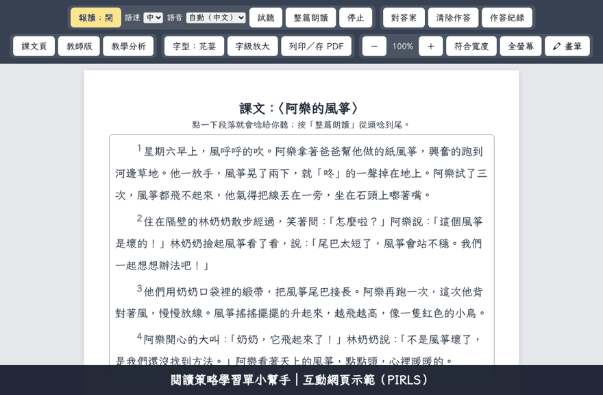

| PIRLS 多層次提問 | KWL | SQ3R |
|---|---|---|
| [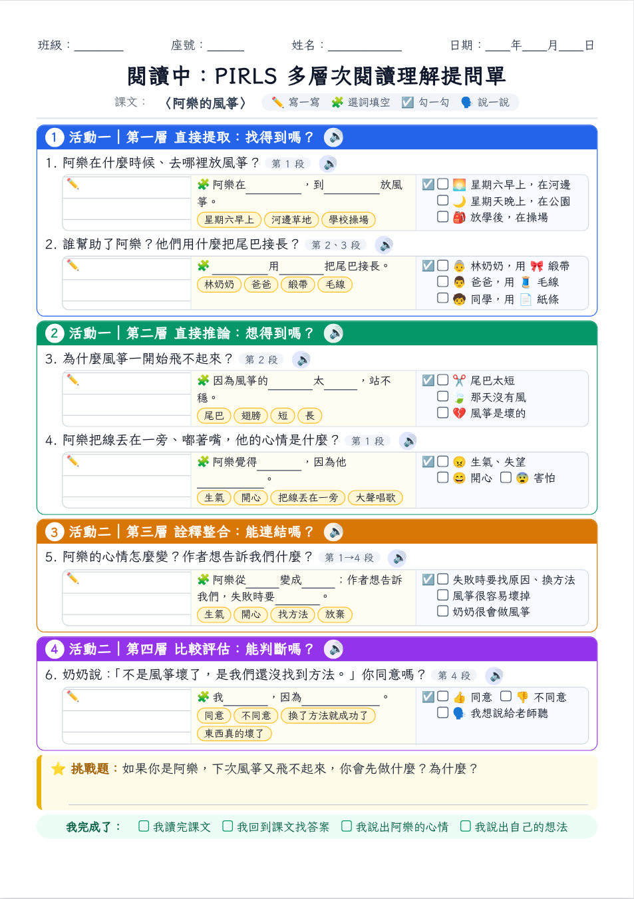](範例/阿樂的風箏_PIRLS學習單.pdf) | [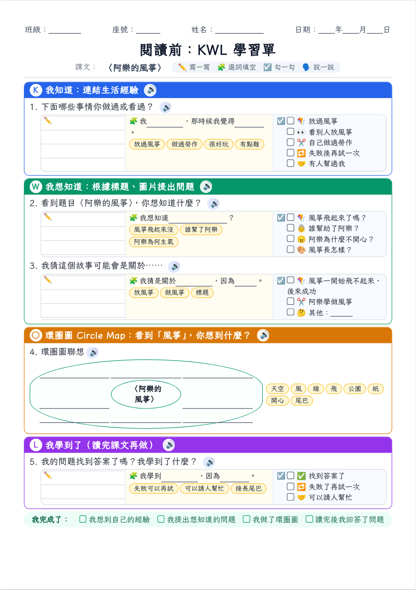](範例/阿樂的風箏_KWL學習單.pdf) | [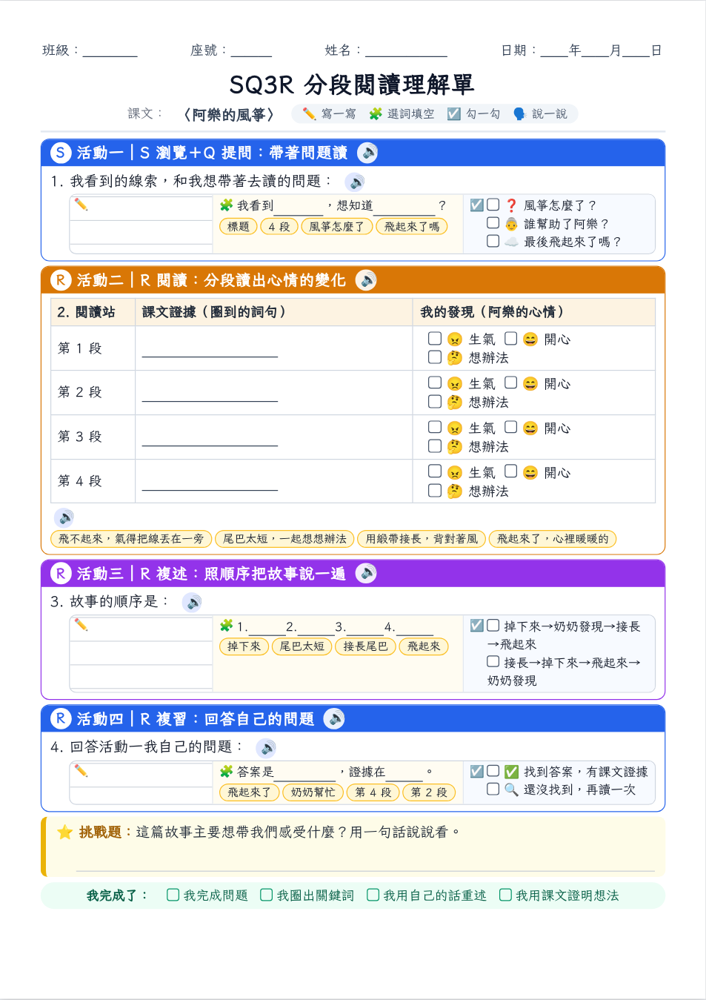](範例/阿樂的風箏_SQ3R學習單.pdf) |
| **4F 反思** | **六何法** | **思考地圖** |
| [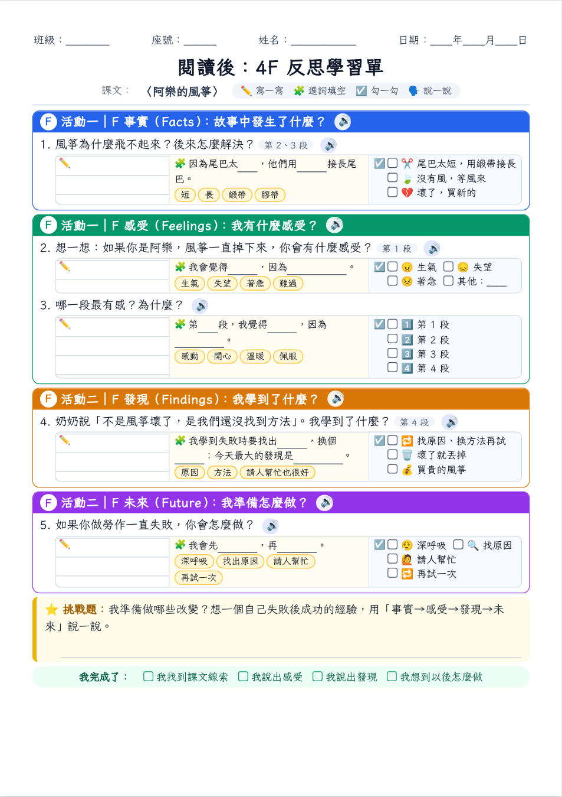](範例/阿樂的風箏_4F學習單.pdf) | [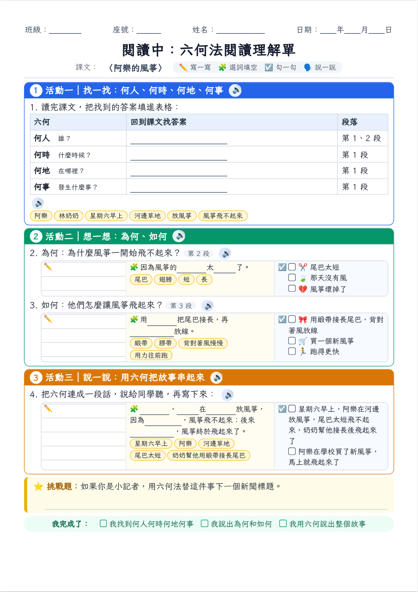](範例/阿樂的風箏_六何法學習單.pdf) | [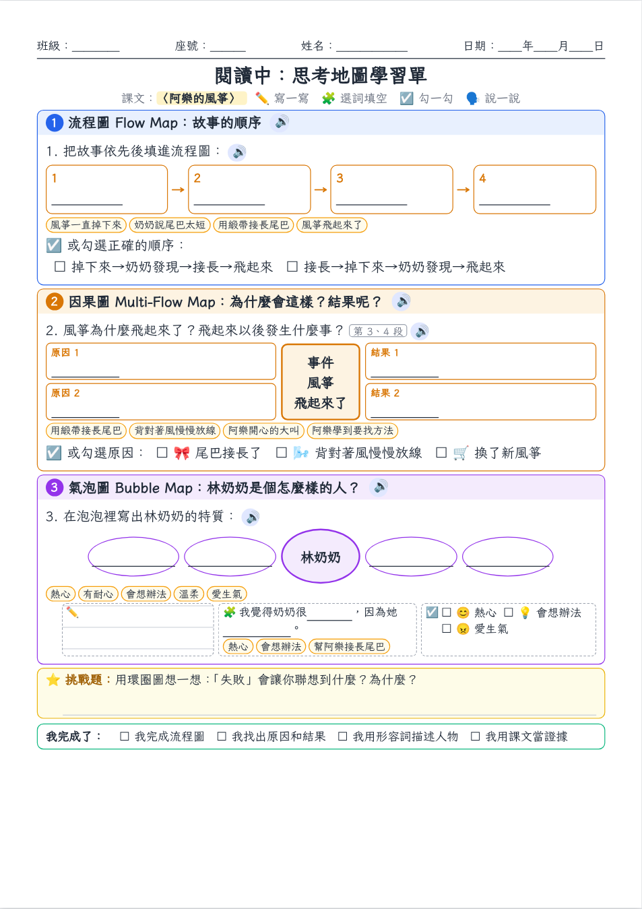](範例/阿樂的風箏_思考地圖學習單.pdf) |
| **故事地圖** | **交互教學** | **找大意** |
| [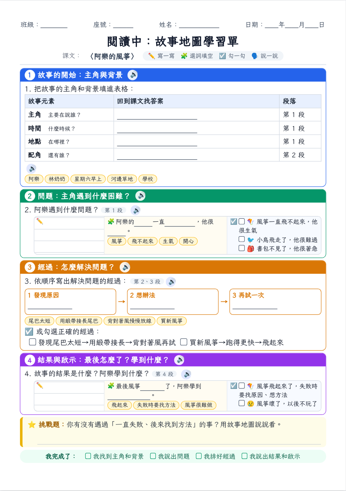](範例/阿樂的風箏_故事地圖學習單.pdf) | [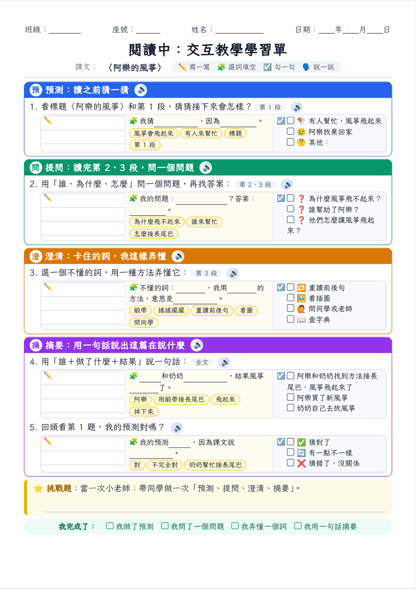](範例/阿樂的風箏_交互教學學習單.pdf) | [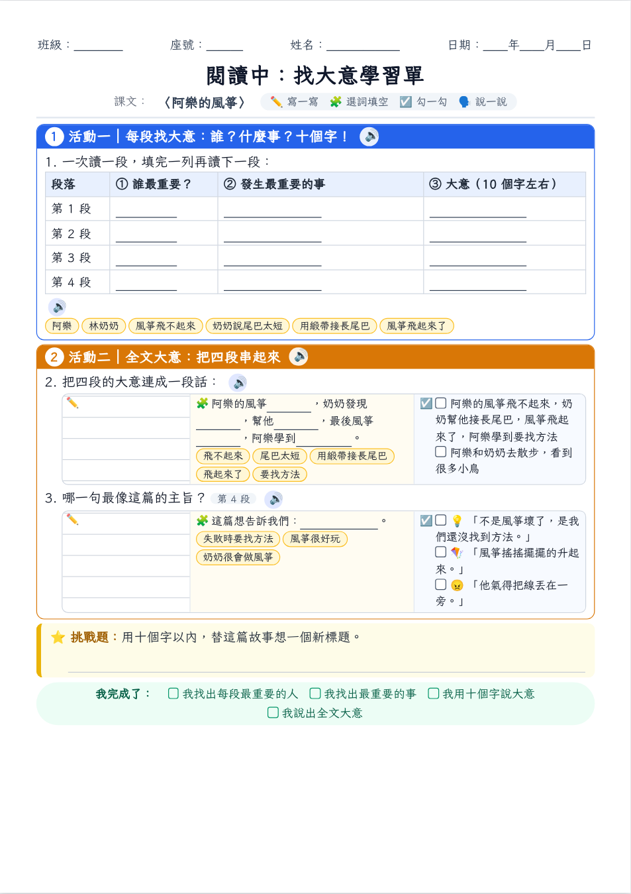](範例/阿樂的風箏_找大意學習單.pdf) |

點圖片可以看學生用 PDF（課文頁＋學習單）；`範例/` 也有可編輯的 Word 檔（.docx，版面和網頁一樣）；教師版另有一份 PDF（`範例/` 裡檔名有「_教師版」的，含學習目標、教學提示、課程調整、答案與教學分析）。

每份範例的網頁裡都有「教學分析」頁（預設隱藏，按工具列「教學分析」顯示），放模組一到三的全部分析表：

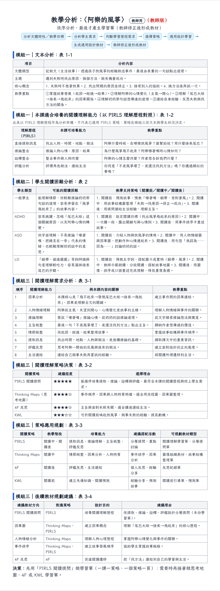
教師版附課程調整四面向與答案：

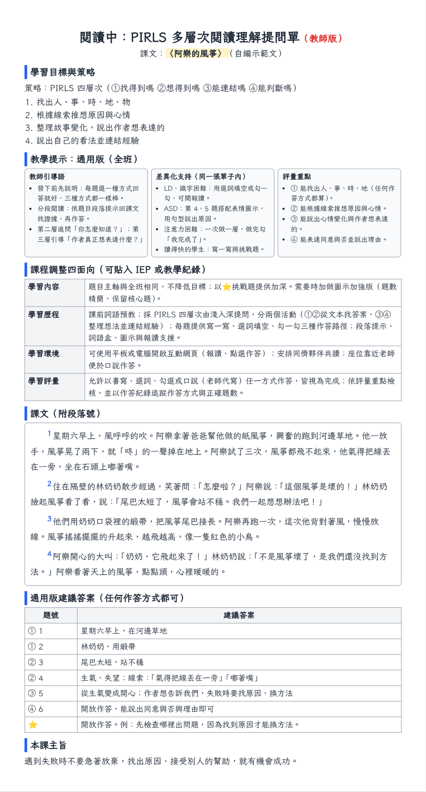

## 最快的用法：在任何 AI 輸入一句話

在 Claude、ChatGPT、Gemini 的對話框輸入：

```
安裝skill
https://github.com/sesns365/reading-strategy-worksheet
```

AI 會讀取這個 repo 的規則與模板，在這次對話中變成「閱讀策略學習單小幫手」，接著貼上課文、說明學生就好。這是「本次對話啟用」，開新對話要再輸入一次；想每次都能用，請看下面的「安裝方式」。

Gemini 常常讀不到 GitHub 網址。讀不到時，改貼純文字網址：

```
安裝skill
https://raw.githubusercontent.com/sesns365/reading-strategy-worksheet/main/gpt-gemini/instructions.md
```

還是不行，就把 `gpt-gemini/instructions.md` 全文貼進對話（見下方「貼上版」）。

## 支援的閱讀策略

| 策略 | 適合 | 學習單結構 |
|---|---|---|
| KWL | 新課導入、背景知識不足 | 閱讀前：K 我知道、W 我想知道、環圈圖；讀後 L 我學到了 |
| SQ3R | 長文、容易分心、抓不到重點 | 四個活動：瀏覽提問、分站閱讀表、照順序複述、回答自己的問題 |
| PIRLS 多層次提問 | 理解檢核、推論困難 | 活動一 ① 直接提取 ② 直接推論；活動二 ③ 詮釋整合 ④ 比較評估 |
| 4F 反思 | 品格、SEL、不敢表達 | 事實、感受、發現、未來 |
| 六何法 | 抓不到重點、識字困難、輕度智障 | 閱讀理解：找何人何時何地何事、想為何與如何、用六何串成摘要（分層寫作請用[六何法分層寫作小幫手](https://github.com/sesns365/six-w-writing)） |
| 思考地圖 | 需要視覺結構、因果與順序明顯 | 流程圖、因果圖、氣泡圖（說明文可用樹狀圖） |
| 故事地圖（特教實證） | 讀後即忘、自閉症、學障、輕度智障 | 主角與背景、問題、經過、結果與啟示（故事結構教學） |
| 交互教學（特教實證） | 推論困難、小組合作 | 預測、提問、澄清、摘要，學生輪流當小老師（Palincsar & Brown、CSR） |
| 找大意（特教實證） | 抓不到重點、長文、說明文 | 每段找最重要的人和事，寫十個字左右的大意，再串成全文大意（PALS Get the Gist） |

分析完只產出這一課的一份學習單。所有學習單都是 **UDL 通用版**：全班同一張，每題都能選 ✏️ 寫一寫、🧩 選詞填空、☑️ 勾一勾，也可以口說；最後有 ⭐ 挑戰題。範例都在 `範例/` 資料夾（示範課文〈阿樂的風箏〉）。

## 學生現況：用說的就可以

不用記代碼，直接描述學生狀況，AI 會自己分析並判讀成對應的困難類型，在模組二的分析表上方寫出判讀結果讓你確認。例如：

```
三年級〈阿樂的風箏〉（貼上課文）
班上有兩個孩子讀完就忘記內容，一個看不懂角色的心情，寫句子常常只寫半句
```

熟悉代碼的老師也可以用代碼快速輸入，或兩者混用：

- 類別：A 一般學生、B ADHD／情緒行為障礙、C 自閉症、D 學習障礙、E 輕度智能障礙
- 困難：1 讀後即忘、2 不懂角色感受、3 不知道重點、4 寫心得崩潰、5 不知如何開始、6 識字解碼困難、7 推論困難、8 不敢表達、9 句子寫不完整

代碼範例：

```
四年級〈阿樂的風箏〉（貼上課文）
學生：C2、D3，資源班課後複習用
```

## 安裝方式

先點本頁上方綠色的「Code」按鈕，選「Download ZIP」，解壓縮。

| 資料夾／檔案 | 給誰用 |
|---|---|
| `reading-strategy-worksheet/` | Claude、Gemini（直接匯入成技能） |
| `gpt-gemini/instructions-gpt.md` | ChatGPT（貼到「指示」，精簡版，8000 字以內） |
| `gpt-gemini/instructions.md` | 完整版，貼在任何 AI 的對話開頭 |
| `gpt-gemini/example-template.html`、`gpt-gemini/blueprints.md` | ChatGPT（上傳成「知識」檔案） |

### Claude

1. 把 `reading-strategy-worksheet` 資料夾單獨壓縮成 zip（內含 `SKILL.md`、`references`、`scripts`）。
2. 到 Claude 的「設定 → 功能（Capabilities）→ Skills」上傳這個 zip。
3. 開新對話，貼上課文並說明學生，skill 會自動啟用。

Claude Code 使用者可直接把 `reading-strategy-worksheet` 資料夾放到 `~/.claude/skills/`。Claude Code 可以執行 `scripts/export.py`，直接產出 PDF 與 Word。

### ChatGPT（建立 GPT）

1. 左側「GPT」→「建立」→ 切到「設定（Configure）」。
2. 名稱：閱讀策略學習單小幫手。
3. 「指示（Instructions）」：打開 `gpt-gemini/instructions-gpt.md`（精簡版，符合 GPT 指示 8000 字上限），全文複製貼上。
4. 「知識（Knowledge）」：上傳 `gpt-gemini/example-template.html` 與 `gpt-gemini/blueprints.md`。
5. 「功能」：勾選「Canvas」「程式碼解譯器」與「圖像生成」。
6. 對話開場白可填：「我要做閱讀策略學習單」「這是課文，學生是 D3，請幫我推薦策略」。

### Gemini（技能 Skills）

1. 用電腦網頁版或 Mac App 開啟 Gemini，到「自訂（Customize）→ 技能（Skills）」。
2. 選擇匯入，選取整個 `reading-strategy-worksheet` 資料夾。資料夾名稱不要改。
3. 對話中輸入 `/reading-strategy-worksheet`，或直接貼課文說「幫我做閱讀策略學習單」。

注意：Gemini 的技能目前不能和 Canvas 一起使用，學習單會以 HTML 程式碼輸出，請複製後存成 `.html` 檔，用瀏覽器開啟。想用 Canvas 預覽時，改用下面的「貼上版」。

### 任何 AI 都能用的貼上版

在新對話開頭貼上 `gpt-gemini/instructions.md` 全文（可同時附上 `example-template.html`），送出後再貼課文與學生現況。Gemini 這樣用可以搭配 Canvas。

### 三種 AI 的差別

- **Claude**：規則最完整，含九種策略範例檔；Claude Code 可直接匯出 PDF 與 Word。
- **Gemini**：匯入同一份 skill，規則一樣完整；技能模式不能搭配 Canvas。
- **ChatGPT**：用精簡版指示加知識檔，流程與模板相同；有程式碼解譯器時可另外產出 Word。
- 不論哪一種，PDF 都可以在瀏覽器開啟 HTML 後「列印 → 另存為 PDF」。

## 互動網頁功能

- 🔊 報讀：題目、選項、課文段落都能點讀，可整篇朗讀、調語速（建議 Chrome 或 Edge）
- 直接點選作答、打字填空、點詞語自動填入
- 對答案、作答紀錄（可複製或列印，方便 IEP 進步監控）
- 🗣 語音風格可選：列出電腦或平板內建的中文語音，選了自動試聽並記住
- 🔍 頁面放大縮小、符合寬度、全螢幕，投影或平板上課都清楚
- 🖍 畫筆：多色畫筆、螢光筆、粗細、橡皮擦、復原、全部清除，捲動或縮放筆跡都不會跑掉
- 📋 作答紀錄自動附「給老師的下一步建議」：哪一節沒作答或答錯、常用哪種作答方式、下一份怎麼調整
- 字型三種切換：芫荽（預設）、標楷（教育部標準楷書優先）、芫荽注音（字旁自帶注音），都符合教育部標準字形與筆順；字級放大
- 打開時只看到課文頁和學生學習單，版面乾淨、可直接書寫；教師版、教學分析按鈕一按才顯示
- 教師版含課程調整四面向（學習內容、歷程、環境、評量）

## 授權與來源

由特工365 整理。改編自：https://courses.dale.nthu.edu.tw/repo/14342
